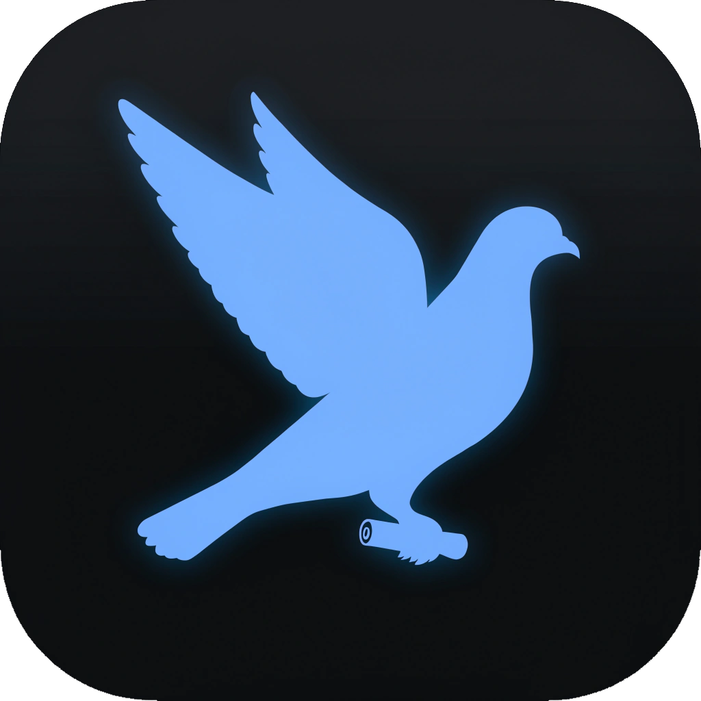

<!-- TODO: add the icon at assets/brand/pigeon-icon.png (dark rounded tile, glowing pigeon silhouette carrying a message roll), then uncomment:

  

-->

<h1 align="center">Postal Pigeon</h1>

<strong>The Hedgerow push relay. A small service that rings the doorbell on your iPhone when your own server has something to tell you, and never learns what it is.</strong>

  
  

> **Status: design phase. Nothing is usable yet, and there is no release date.** This repository contains the design,
> the threat model and the security policy. There is no code to install or run.

Postal Pigeon ("Pigeon") is the push-notification relay for [Hedgerow](https://hedgerow.tools/), a family of small
self-hosted apps. The repository is called Hedgerow-Relay for now.

## Why it exists

Apple only lets the holder of an app's push key send notifications to that app. The Hedgerow iOS apps (the Hedgerow
app for [Vigilant Vole](https://hedgerow.tools/Vigilant-Vole/), [Keen Kestrel](https://hedgerow.tools/Keen-Kestrel/)
and [Wise Wren](https://hedgerow.tools/Wise-Wren/), and later [Faithful Ferret](https://hedgerow.tools/Faithful-Ferret/))
talk to servers that **you** host, and those servers cannot hold the publisher's key. So your server asks Pigeon to
send the push, and Pigeon asks Apple.

Android does not use Pigeon. Android builds use UnifiedPush through a distributor you choose, such as ntfy.

## Who runs it

The official Pigeon is run by the Hedgerow maintainer. The official apps use it. Push is **off by default** on every
server and optional: the apps work without it and simply update when you open them or when iOS refreshes them in the
background. Because the push key belongs to the official apps, someone who builds their own app version runs their own
Pigeon with their own Apple developer account. The code is open for exactly that reason.

## Privacy in plain words

- A push says only "something changed, ask your server" or "sync now". It never says what. Notifications that show
  details are written **on your phone** after it asks your own server.
- Pigeon keeps a device address (Apple's push token for your phone), an opaque handle per connected server, and small
  counters for rate limits. It does not keep names, accounts, e-mail addresses, server addresses or content.
- Your server never sees your phone's push token, and the relay is built so that no stored record links your phone to a
  particular server.
- The operator can see your phone's push token and when pushes happen, and the internet address of your phone and of
  your server while a request is handled. A modified relay could also log which server rang which handle. These
  limits are written down in the [privacy statement](docs/design.md#14-privacy-statement).
- Apple sees the token, the time and the tiny content-free message, as it does for every iOS push.
- You can turn push off, revoke a single server from the app, or delete your device at any time.

## Design

The full design is in [`docs/design.md`](docs/design.md): the API, how servers and phones register, what is stored and
for how long, rate limits and abuse controls, key handling, deployment, and a threat model covering malicious servers,
stolen credentials, a compromised relay and a leaked push key. The open questions are at the end.

Planned shape: one small container with SQLite, written in Rust like the other Hedgerow servers, behind a TLS reverse
proxy, with a health endpoint.

## Contributing

Pigeon is not open for contributions yet. When it is, a contributor licence agreement will be required for code
contributions. Until then, issues and ideas are welcome on the [issue tracker](https://github.com/Ferdinand99/Hedgerow-Relay/issues).
Please report security problems privately, as described in [`SECURITY.md`](SECURITY.md).

Postal Pigeon is part of [Hedgerow](https://hedgerow.tools/), with [Vigilant Vole](https://hedgerow.tools/Vigilant-Vole/),
[Nimble Newt](https://hedgerow.tools/Nimble-Newt/), [Keen Kestrel](https://hedgerow.tools/Keen-Kestrel/),
[Wise Wren](https://hedgerow.tools/Wise-Wren/) and [Faithful Ferret](https://hedgerow.tools/Faithful-Ferret/).

## License

[GNU AGPL-3.0-only](LICENSE)
