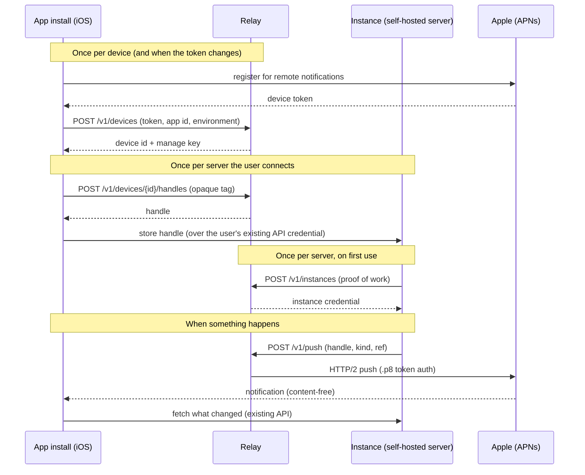

# Postal Pigeon: design

Postal Pigeon ("Pigeon") is the Hedgerow push relay. In this document, "the relay" means Postal Pigeon. The repository is
called Hedgerow-Relay for now.

Status: design phase. This document describes what will be built. Nothing here is implemented, and details may
still change before the first release.

## Contents

1. [Purpose](#1-purpose)
2. [Non-goals](#2-non-goals)
3. [Actors and trust](#3-actors-and-trust)
4. [Overview](#4-overview)
5. [Credentials and identifiers](#5-credentials-and-identifiers)
6. [API, version 1](#6-api-version-1)
7. [Payload rules](#7-payload-rules)
8. [APNs specifics](#8-apns-specifics)
9. [Data stored and retention](#9-data-stored-and-retention)
10. [Rate limits and abuse controls](#10-rate-limits-and-abuse-controls)
11. [Key handling](#11-key-handling)
12. [Deployment](#12-deployment)
13. [When the relay is down](#13-when-the-relay-is-down)
14. [Privacy statement](#14-privacy-statement)
15. [Versioning](#15-versioning)
16. [Threat model](#16-threat-model)
17. [Open questions](#17-open-questions)

---

## 1. Purpose

Apple only lets the holder of an app's APNs key send push notifications to that app. Hedgerow publishes iOS apps
that talk to **self-hosted servers run by many different people**: the Hedgerow app (one app for a user's own
Vigilant Vole, Keen Kestrel and Wise Wren) and, later, Faithful Ferret (a zero-knowledge password manager). A
self-hosted server cannot hold the publisher's APNs key, because anyone who runs the server would then hold it.

The relay solves exactly this. A server asks the relay to wake one specific app install, and the relay, which holds
the APNs key, asks Apple to do it. The relay is a **dumb, content-free doorbell**: the push says "something changed,
ask your own server", never what changed.

Android does not use the relay. Android builds use UnifiedPush through a distributor the user picks (for example
ntfy), and the server talks to that distributor directly. The payload rules in section 7 are recommended there too,
but the relay plays no part.

### Design rules (already decided)

- A push carries only "sync now" or "look at this", with no secrets and no server content.
- Self-hosted servers must register before they can send, and receive a credential, much like an installation id.
- Rate limits apply to servers, devices and apps.
- The relay stores nothing beyond what it needs to deliver: device tokens, handles and small counters.
- The apps work if the relay is down. Push is an acceleration, never a requirement.
- The operator of the relay can see device tokens and timing as metadata. This is documented in section 14.

## 2. Non-goals

- **Not a message queue or a store.** There is no durable queue. A push the relay could not hand to Apple is not
  kept for later.
- **No content.** No monitor names, host names, error messages, vault item names, user names or counts ever pass
  through the relay or Apple. See section 7.
- **No accounts.** Users do not sign up for the relay. There is no web interface for users.
- **No analytics.** The relay does not measure users, only aggregate health and abuse counters.
- **No Android or web push.** UnifiedPush and Web Push are handled between the server and the user's own
  distributor.
- **No guaranteed delivery.** APNs itself does not guarantee delivery, and neither does the relay.
- **Not a general push service.** Only app ids configured on the relay can be used. Forks of the apps use their own
  relay and their own Apple developer account.
- **No inbound path to servers.** The relay never calls a self-hosted server and never knows its address.

## 3. Actors and trust

| Actor | Who | Trusted with |
|---|---|---|
| **Relay operator** | The Hedgerow maintainer, who runs the official relay | The APNs key, the device-token database, and the metadata in section 14. Trusted not to read or act on content (there is none), but the design limits the damage if this trust is misplaced or the relay is compromised. |
| **Instance** | A self-hosted server (Vigilant Vole, Keen Kestrel, Wise Wren, Faithful Ferret) run by any person | Only the handles its users gave it, and its own credential. Treated as **untrusted** by the relay: it may be buggy, misconfigured or hostile. |
| **App install** | One copy of an iOS app on one device | Its own device token and its manage key. It trusts the relay only to deliver "wake up" signals, never to tell it what to do. |
| **Apple (APNs)** | Delivers the push | Sees the device token, the topic (bundle id), timing and the tiny payload. |
| **Network attacker** | Anyone between parties | Nothing. All traffic is TLS. |

Trust boundaries that matter most:

- The **app never acts on push content** beyond fetching from its own, already configured servers.
- The **relay never learns the address of an instance** and holds no credential for any instance's API.
- An **instance never learns a device token**, only an opaque handle.

## 4. Overview



A push has three steps and two hops that matter: instance to relay (authenticated by the instance credential and a
handle), relay to Apple (authenticated by the APNs key), and then the app asks its **own** server what happened.

## 5. Credentials and identifiers

All secrets are random, at least 256 bits, URL-safe, and prefixed so that leaked ones are recognisable in logs and
secret scanners. The relay stores **only hashes** (SHA-256) of secrets that clients present, except device tokens,
which it must be able to use (they are sealed at rest, see section 9).

| Name | Prefix | Held by | Purpose |
|---|---|---|---|
| Instance credential | `hrk_` | Instance (sealed in its own database) | Authenticates `POST /v1/push` and instance management. The first characters are a public instance id, so the relay can look it up without scanning. |
| Device id | `hrd_` | App | Names a device record. Not secret on its own. |
| Manage key | `hrm_` | App only (keychain, this device only) | Authenticates device, handle and refresh calls. Never leaves the device. |
| Handle | `hrh_` | App creates it, then gives it to one instance | A **send capability** for one (device, server connection) pair. Has a public id, used to revoke it. |
| Tag | none | App, echoed back in the payload | An opaque 16-byte value the app picks per handle, so it can tell which connection a push belongs to without the relay knowing. |
| Device token | none | Apple, app, relay | The APNs address of one app install. Never given to instances. |

## 6. API, version 1

JSON over HTTPS. Every path starts with `/v1`. Requests and responses use `Content-Type: application/json`,
bodies are limited to 2 KiB, and unknown fields are ignored (see section 15). Errors look like
`{"error": "<code>", "message": "<text>"}` with a stable code. Authentication is `Authorization: Bearer <secret>`.

### 6.1 Instance registration (no manual approval)

Registration is open, without a human approving each instance. This is safe because an instance's **reach is limited
to handles that users gave it**: a freshly registered instance can send nothing to anyone. What registration buys is
accounting, rate limiting and the ability to suspend a misbehaving instance. Cheap spam is made expensive by three
layers: a small proof of work, per-address limits, and a low initial quota (the "new" tier).

**`GET /v1/challenge`** returns `{ "challenge": "...", "difficulty": 20, "expires_at": "..." }`. The challenge is
stateless: a timestamp and random bytes, signed with an HMAC key held by the relay. It is valid for five minutes
and can be used once (a small in-memory set remembers used challenges until they expire).

**`POST /v1/instances`**

```json
{ "challenge": "...", "nonce": "...", "product": "vigilant-vole", "version": "0.14.0" }
```

The client finds a nonce for which `SHA-256(challenge || nonce)` has at least `difficulty` leading zero bits. At 20
bits this costs a typical server about a second and is trivial for a legitimate single registration. The `product`
is one of a fixed list (`vigilant-vole`, `keen-kestrel`, `wise-wren`, `faithful-ferret`) and, with `version`, is
informational only: it helps the operator see which releases use the relay, and is not an identity proof.

Response `201`:

```json
{ "instance_credential": "hrk_...", "tier": "new", "limits": { "...": "..." } }
```

The credential is shown once. The instance seals it in its own database. The relay never receives the instance's
address or name, and the registration does not ask for one.

When an instance registers: **only when an administrator turns push on** and an app asks for it. Push is off by
default on every server, and the settings page says what it means (a short version of section 14).

**`POST /v1/instances/self/rotate`** (authenticated) returns a new credential and invalidates the old one at once.
**`DELETE /v1/instances/self`** (authenticated) removes the registration.

If the relay answers `401 unknown_instance` (for example after a database loss), an instance registers again. If it
answers `403 suspended`, it does not, and tells its administrator.

### 6.2 Device registration: three options compared

The device has an APNs token. Someone has to give it to the relay, and someone has to tell the server how to
address the device.

| | **A. Server registers the device** | **B. App registers, hands an opaque handle to its server (recommended)** | **C. App registers and the server stores the device token** |
|---|---|---|---|
| Who talks to the relay about a device | The server, after the app sends it the token | The app, directly | The app, then the server too |
| What the instance learns | The raw device token | An opaque handle, nothing else | The raw device token |
| Does the relay durably learn which instance a device belongs to | **Yes**: the registration names both | **No**: the relay stores device and handles, never instances | Yes, if the server registers it |
| What the relay sees at send time | Instance and device | Instance and handle, **in one request only** (not stored or logged jointly) | Instance and device |
| Token rotation (APNs changes tokens now and then) | The app must update every server, and each server the relay | The app updates the relay **once**; no server needs to know | As A |
| User cuts off one server | Delete from that server, trust it to comply | App revokes that server's handle at the relay, **enforced by the relay** | As A |
| Malicious server holding a leaked token | Can try to push to it for as long as the token is valid, and can share it | A handle works only through relay limits, can be revoked, and is useless without an instance credential | As A |
| Fits "the app talks only to the user's servers" | Yes | Yes. The app tells the relay about a device, never about a server. | Yes |
| App work | Small | Slightly more: a second API client and key storage | Small |
| Relay down at setup | Registration fails until it is back | Same; the app retries on each launch | Same |

**Recommendation: B.** The relay's job is to turn "a handle plus a request" into a push. With B, the relay can be
built so that no stored record ever connects an instance to a device:

- Device records and handle records are linked to each other, never to an instance.
- Instance records are never linked to a handle or device.
- Rate-limit counters are kept **separately** per instance and per handle (in memory), not per pair. The relay has
  no need for a table of pairs.
- At send time the relay necessarily sees the pair for the duration of the request, since it must route the push.
  A relay operator who wants to log that can. This is stated plainly in section 14 and is the reason the design
  is "as far as practical" and not "impossible". Blinded credentials (Privacy Pass-style tokens) could remove even
  this and are noted in section 17.

B also moves the most sensitive item, the device token, **away from third parties' servers entirely**, gives the user
a real revocation switch (the relay refuses a revoked handle regardless of what the instance does), and makes token
rotation a single call instead of one per server.

### 6.3 Devices and handles (app, no account)

**`POST /v1/devices`** (unauthenticated, rate limited by address, see section 10)

```json
{ "app": "hedgerow", "environment": "production", "token": "<hex device token>" }
```

`app` must be an id configured on the relay (`hedgerow`, later `ferret`). `environment` is `production` or
`sandbox` (see section 8). The token must look like an APNs token (hexadecimal, 32 to 200 bytes).

Response `201`: `{ "device_id": "hrd_...", "manage_key": "hrm_..." }`.

If a record for the same token already exists, it is **replaced** (the old device id and its handles stop working).
The device token is itself the proof of possession: it is secret, random, and known only to Apple, the app and the
relay. This is how a reinstall that lost its keychain recovers.

**`PUT /v1/devices/{device_id}`** (manage key) body `{ "token": "...", "environment": "..." }`. Updates the token
when APNs hands the app a new one, and counts as a keep-alive. The app calls it on launch, at most once a day.
Returns `204`, or `404` if the record was removed (the app then registers again and re-issues its handles).

**`DELETE /v1/devices/{device_id}`** (manage key) removes the device and every handle. Returns `204`.

**`POST /v1/devices/{device_id}/handles`** (manage key) body `{ "tag": "<16 bytes, base64url>" }`.
Response `201`: `{ "handle_id": "...", "handle": "hrh_..." }`. At most 32 handles per device.

**`GET /v1/devices/{device_id}/handles`** (manage key) lists `handle_id`, `tag`, `created` and `last_used` (a date,
no time of day) for each handle, so the app can show "this server last pushed on Tuesday".

**`DELETE /v1/devices/{device_id}/handles/{handle_id}`** (manage key) revokes one handle at once.

The app hands the handle to its server over the credential it already uses with that server. The server stores it
next to the user (or device) it belongs to. **The server only sends to a relay URL configured by its administrator
(default: the official relay), never to one the app names.** Otherwise an app, or someone who tricked it, could point
the server's credential at any address.

### 6.4 Send

**`POST /v1/push`** (instance credential)

```json
{
  "event_id": "7f6c8e0e-5d1b-4a43-9d3e-0c1d9b1b2a77",
  "handles": ["hrh_...", "hrh_..."],
  "kind": "alert",
  "ref": "inc_9f3a1c",
  "collapse": "inc_9f3a1c",
  "ttl": 3600
}
```

| Field | Rule |
|---|---|
| `event_id` | Required, a UUID. Repeats within 15 minutes are acknowledged but not sent again (replay and retry safety). |
| `handles` | 1 to 25 handles. The same push goes to all. |
| `kind` | `alert` (a visible notification with fixed, generic text) or `sync` (a silent "fetch now"). Which kinds are allowed is set per app on the relay. |
| `ref` | Optional opaque id, at most 64 characters of `A-Z a-z 0-9 _ -`. The app uses it to fetch the right thing. Instances should use random ids, not counters. |
| `collapse` | Optional, at most 32 of the same characters. Pushes with the same value replace each other at Apple. |
| `ttl` | Optional seconds to keep trying, 60 to 86400. Defaults are in section 8. |

Response `200`, with one result per handle, in order:

```json
{ "results": [ { "status": "accepted" }, { "status": "gone" } ] }
```

| Status | Meaning and what the instance should do |
|---|---|
| `accepted` | Apple took the push. (Not a promise that the device got it.) |
| `duplicate` | The `event_id` was already handled. Nothing sent. |
| `gone` | The handle is unknown, revoked, or its device is no longer valid. **Forget the handle.** The relay answers the same for "never existed" and "revoked" so handles cannot be probed. |
| `limited` | A limit applied to this handle or device. Retry no sooner than `retry_after` (seconds) or drop it. |
| `unavailable` | Apple or the relay could not deliver now. A retry later may work. |

Whole-request failures: `401 invalid_credentials` or `unknown_instance`, `403 suspended`, `400 invalid_request`,
`413 too_large`, `429 rate_limited` with a `Retry-After` header, `503 overloaded` with `Retry-After`. Sending is
**synchronous and in-process**: the relay calls Apple and answers within about five seconds, so the instance gets
the real outcome without the relay running a queue.

### 6.5 Status and health

- **`GET /healthz`** returns `200 ok` if the process is up and the database answers. This is what Vigilant Vole
  monitors, in the same style as the rest of the family. It reveals nothing else.
- **`GET /v1/status`** (public) returns `{ "api": [1], "apns": "ok" | "degraded" | "unknown", "version": "..." }`.
  `apns` reflects recent results of real sends, not a call to Apple. Instances and apps may show "push available" from it.
- There is no public list of instances, devices or counts.

## 7. Payload rules

**Decision: the relay's payload is always content-free. There is no optional visible text from the instance in
version 1.**

The relay builds the push itself from the validated fields in section 6.4. An instance cannot supply free text. What
the user sees is produced **on the device**:

- `sync`: a silent push (`content-available`). The app fetches from its own servers. No user-visible text at all.
- `alert`: a visible notification with **fixed, localised text that lives in the app**, selected with `loc-key`
  (for example "Something needs attention"), plus `mutable-content`. The app's Notification Service Extension wakes
  up, fetches the real details from the user's own server with the credential in the shared keychain, and rewrites the
  notification locally ("Monitor *api* is down"). If it cannot (no network, server down, time limit), the generic
  text stays. The user always gets a notification, and the relay and Apple never get the details.

The push body, in full, for an alert:

```json
{
  "aps": {
    "alert": { "title-loc-key": "HR_PUSH_TITLE", "loc-key": "HR_PUSH_BODY" },
    "mutable-content": 1,
    "sound": "default",
    "thread-id": "<tag>"
  },
  "hr": { "v": 1, "k": "alert", "t": "<tag>", "r": "<ref>" }
}
```

and for a sync push: `{ "aps": { "content-available": 1 }, "hr": { "v": 1, "k": "sync", "t": "<tag>", "r": "<ref>" } }`.

Why not let a user opt in to short visible text from the instance?

- It would send host names, monitor names or worse through the relay and Apple, which breaks the privacy statement
  for everyone who has not read it, and for a password manager it is simply unacceptable.
- The extension gives the same result for the user (a specific notification) without the relay or Apple seeing it.
- An opt-in needs a per-instance and per-user switch, a way to enforce it on the relay, and a way to show it in the
  app: more surface for something the extension already does better.
- It keeps the abuse story simple. An instance cannot make the official app display text of its choosing, so the
  relay cannot be used to phish through the app's icon.

The cost is one extra fetch when an alert arrives, and an app that must ship a Notification Service Extension. If
real demand appears, a later API version can add it behind an explicit opt-in (section 15).

Rules for the app that go with this:

- **Never act on push content.** The only things an app does with a push are: show the fixed text, fetch from its own
  configured servers, and update what it shows. It never opens an address from a push, never takes a server address,
  token or command from it, and never trusts `ref` as anything more than a lookup key.
- Treat `hr.v` as a version. Unknown versions are handled as a plain "sync now".
- Ferret allows `sync` only. The app decides after the fetch whether to post a local notification.

Instances should choose `ref` values that are random ids, not counters or anything derived from content, and should
batch bursts (for example one `alert` per incident, not per check) to stay far below the limits.

## 8. APNs specifics

- **Authentication:** token-based, with one `.p8` key from the Apple Developer account (the key works for every app
  of the team, and for production and sandbox if both are enabled on it). The relay signs an ES256 JWT with the key
  id (`kid`) and the team id (`iss`), reuses it, and refreshes it about every 40 minutes. Apple rejects providers that
  refresh more often than every 20 minutes (`TooManyProviderTokenUpdates`) and tokens older than 60 minutes
  (`ExpiredProviderToken`).
- **Transport:** HTTP/2 to `api.push.apple.com` for production and `api.sandbox.push.apple.com` for sandbox, kept
  open and reused. The relay does not open a connection per push, which Apple treats as abusive. Concurrency per
  connection is capped well below what the server allows.
- **Topics:** `apns-topic` is the **bundle id** of the app the handle's device registered as. The relay has a fixed
  map from app id to bundle id (for example `hedgerow` to the Hedgerow app's bundle id, and `ferret` to Ferret's own
  bundle id), plus the kinds each app may use. Unknown app ids are refused at registration.
- **Environments:** development builds from Xcode use the sandbox. TestFlight and App Store builds use production.
  The app reports which one it is when it registers, because tokens only work in the environment that issued them.
- **Push type and priority:**

  | Kind | `apns-push-type` | `apns-priority` | Default expiry |
  |---|---|---|---|
  | `alert` | `alert` | 10 | 1 hour |
  | `sync` | `background` | 5 (required by Apple for background pushes) | 15 minutes |

  Expiry is sent as an absolute time in `apns-expiration`, never 0. A stale alert is cut off rather than shown hours
  late; the extension fetch shows the true current state anyway.
- **Collapse ids:** `apns-collapse-id` is built from the instance's `collapse` value when given (`a-<collapse>`), for
  `sync` as `s-<tag>` so a burst of syncs for one connection becomes one, and is omitted otherwise. It never exceeds
  64 bytes.
- **Message id:** the relay sets `apns-id` to a fresh UUID per push and keeps it only in memory for the duration of the
  call, for matching answers.
- **Handling answers:**

  | Apple answers | The relay does |
  |---|---|
  | `200` | Result `accepted`. Updates the handle's `last_used` date. |
  | `410 Unregistered` | Deletes the device and its handles, **but only if the `timestamp` Apple returns is later than the time the token was registered**, so a token re-registered a moment ago is not deleted by an old answer. Result `gone`. |
  | `400 BadDeviceToken`, `400 DeviceTokenNotForTopic` | Counts a strike on the device. Three strikes in a row delete it. A common cause is an app that registered with the wrong environment. Result `gone` at the third strike, `unavailable` before. |
  | `403 ExpiredProviderToken` | Builds a new JWT (within the 20-minute rule) and retries once. |
  | `403 InvalidProviderToken`, `MissingProviderToken`, `BadCertificate*`, `Forbidden` | An operator problem, never the device's. Raises an alarm, marks `apns` as `degraded`, and does not delete anything. |
  | `429 TooManyRequests` | Backs off for that device and honours `Retry-After` when present. Result `limited`. |
  | `413 PayloadTooLarge`, `400` other | A bug in the relay, logged without identifiers. Result `unavailable`. |
  | `500`, `503`, timeouts | One retry with a short delay, then `unavailable`. Repeated failures open a per-environment circuit breaker for 30 seconds. |

- **Silent pushes are best-effort.** iOS throttles background pushes, and does not deliver them to an app the user
  force-quit. The apps therefore never rely on `sync`. It makes things fresher; the app also syncs on launch and in
  background refresh.
- **Android:** unaffected, see section 1.

## 9. Data stored and retention

The relay uses one SQLite database (WAL mode) in a data volume.

| Table | Fields | Retention |
|---|---|---|
| `devices` | device id; manage key hash; app id; environment; **device token, sealed** (AES-256-GCM, key id in the record); token fingerprint (HMAC, for uniqueness only); created; last seen (date); strike count | Deleted when the app deletes it, on `410` or three `BadDeviceToken` strikes, or **after 90 days without a keep-alive or a successful push**. A device that has not been seen for 60 days is only flagged. |
| `handles` | handle id; handle hash; device id; tag; created; last used (date) | Deleted with the device, or when revoked. |
| `instances` | instance id; credential hash; product; version (as sent); tier; state (`active`, `suspended`); created; last used (date); address prefix at registration (/24 or /48) for 30 days, then cleared | Deleted by the instance, or after **180 days unused**. |
| `instance_usage` | instance id; day; counts of sends, limited sends, failures | 30 days. Used for tiers and abuse review. No device or handle appears here. |

Kept **only in memory** and lost on restart (this is intended): rate-limit buckets (per instance, per handle, per
device, per address), the set of recent `event_id`s (15 minutes), the set of used challenges (5 minutes), the current
APNs JWT, and the recent APNs result counters behind `apns` in `/v1/status`.

Never stored: the instance's address or name, the content of any push (there is none), the `ref` of a push, any
credential or manage key in clear, or any pairing of an instance with a handle or a device.

**Logs.** The relay writes structured logs for startup, errors and aggregate counters. It does not log tokens,
handles, credentials, `ref` values, `event_id`s or client addresses, and error lines use short codes. The reverse
proxy keeps access logs for at most seven days (an operator promise, see section 14, which the relay cannot enforce).

**Backups.** None are required. The state is disposable by design: if the database is lost, apps find their device
gone on next launch and register again (re-issuing handles to their servers), and instances that get
`unknown_instance` register again. If the operator keeps snapshots, they must be encrypted, contain only sealed
tokens, and be deleted after seven days. Restoring an old snapshot loses suspensions made after it, and the operator
re-applies them.

## 10. Rate limits and abuse controls

Limits are token buckets kept in memory (the family kit already has one, see the vole-kit documentation). The numbers
below are starting values, set by configuration, and will be tuned from real use. Hitting a limit never reaches Apple.

| Scope | Limit |
|---|---|
| **Instance registration** | Proof of work (20 bits). 5 per address (IPv6 /64) per day. 200 per day overall; above that, registration returns `503` until the next day. |
| **Device registration** | 20 per hour and 100 per day per address (IPv6 /64). A hard cap on total rows, with 90-day expiry of silent ones. One record per token. |
| **Handle creation** | 10 per hour per device, 32 live per device. |
| **Send, per handle** | `alert`: 6 per hour (burst 3). `sync`: 30 per hour (burst 5). |
| **Send, per device** (all handles together) | `alert`: 30 per hour. `sync`: 120 per hour. This is what protects a person from several servers at once. |
| **Send, per instance** | "new" tier: 600 per hour. "established" tier (7 days without limit hits or suspensions): 6000 per hour. |
| **Unknown handles, per instance** | 20 `gone` answers per hour, then `429` for the instance, and a flag for review. This blocks enumeration (see section 16). |
| **Per app, global** | A circuit breaker on the total send rate toward Apple, so a flood cannot get the whole topic throttled by Apple. |
| **Request size and time** | 2 KiB bodies, 25 handles per request, 10-second read timeouts, bounded numbers of connections and tracked keys. |

Behaviour when limits are hit: the push is not sent, the result is `limited` (per handle or device) or the request
`429`s (per instance or address), with `Retry-After`.

**Replay.** Every push has an `event_id`. A repeated one inside 15 minutes is acknowledged as `duplicate` and not sent.
All traffic is TLS, so a captured request cannot be replayed by a third party without breaking TLS; the `event_id` also
makes honest retries safe.

**Escalation.** An instance that keeps hitting limits (for example more than 1000 `429`s in a day) is **suspended
automatically** (`403 suspended`) and flagged. The operator can suspend, unsuspend, delete or change the tier of an
instance by hand, delete a device, and revoke the APNs key. Suspending a registered instance is weak on its own,
because registering a new one is cheap, so **the controls that actually protect people are per handle and per
device, and the user's revoke switch in the app**. The operator also publishes a contact address for abuse reports.

**Registration spam.** Spam creates rows, not reach: a device record with no handle given to anyone can receive
nothing, and an instance with no handle can send nothing. Row growth is limited by the per-address limits, a
cap, and expiry.

## 11. Key handling

- **The APNs `.p8` key exists only on the relay host** (and offline as an escrow copy kept by the operator, since
  Apple shows it once). It is never in the image, in the repository, in CI, in an environment variable or in a log. It
  is mounted into the container as a read-only file (for example a Docker secret or a read-only bind mount) with mode
  `0400`, owned by the unprivileged user the container runs as. The relay reads it at start-up and parses it into
  memory; it exposes no way to read it back.
- **Other relay secrets**: the key used to seal device tokens at rest, the HMAC key for challenges and token
  fingerprints. They are supplied the same way (files, mode `0400`) and never stored in the database next to the data
  they protect. The seal key has an id stored with each sealed token, so keys can be rotated: the relay re-seals
  tokens in the background when a new key is added, then the old one is removed.
- **Sealing is a limited defence.** It protects a copied database, a snapshot or a leaked backup. It does not protect
  against someone who controls the running relay, who has the key in memory.
- **Rotation of the APNs key.** Apple allows two active keys per team. Procedure: create a new key, add it with its key
  id to the relay's configuration, restart, send a test push to the operator's own device with the admin command, then
  revoke the old key at Apple. Device tokens belong to the app and team, not to the key, so **no user is affected**.
  Plan for a rotation at least once a year and immediately on any suspicion.
- **If the key leaks:** revoke it at Apple at once (this stops forged pushes immediately), create a new one, deploy.
  See section 16.
- **Instance and device secrets** are random, hashed with SHA-256 at the relay, and compared in constant time.
  Instances can rotate their credential; apps can re-create a device.
- **The container** runs as a non-root user with a read-only root filesystem, no added capabilities and no access to
  the Docker socket, the host or other services' volumes. Only the data directory is writable.

## 12. Deployment

- **One container**, one Rust binary (axum, on the same kit conventions as the other Hedgerow servers), **one SQLite
  database** in a data volume. No other services.
- **Behind the operator's reverse proxy with TLS**, on a public host name. The relay listens on plain HTTP inside the
  container network or on loopback only. The proxy terminates TLS (1.2 or higher, preferably 1.3), sets HSTS, and
  applies a coarse per-address request limit as a first layer. The relay trusts the forwarded client address only from
  the proxy's configured address.
- **Health:** `GET /healthz` for Vigilant Vole and the container health check; `GET /v1/status` as in section 6.5.
- **Configuration** is a small file plus secrets as files: app ids with bundle ids and allowed kinds, Apple team id,
  key id and key path, limits, the HMAC and seal keys, and the proxy's address.
- **Admin:** a command inside the container (`postal-pigeon admin ...`) for statistics, listing and suspending
  instances, deleting devices, changing tiers, sending a test push to a token, and adding a seal key. There is no
  admin web interface in version 1 (see section 17).
- **Releases:** the container image is built in CI from the tagged source, signed, and updated by the operator. The
  relay is AGPL-3.0, so anyone can run their own, with their own Apple developer account and their own app build.
- **Single instance, no clustering.** SQLite and in-memory buckets make this a one-process service. Downtime is
  acceptable by design (next section).

## 13. When the relay is down

Push is an acceleration. It is never required for a feature to work.

- **Apps:** continue to work against their servers. They refresh when opened, on pull to refresh, and in iOS
  Background App Refresh, as in the app's version 1 behaviour. If the relay cannot be reached during setup, the app
  shows "push pending" in settings and retries on each launch. It never blocks anything.
- **Instances:** sending runs in a background task, off the alerting path. A failing relay never delays or drops
  other notification channels (e-mail, chat, webhooks). The instance retries a few times with backoff, gives up when the
  push would have expired anyway, and opens a circuit breaker so a dead relay costs it nothing. It reports "relay
  unreachable" in its own status and, like any dependency, may show it in its health view.
- **Apple down or slow:** the same, seen as `unavailable` results.
- **Database lost:** apps and instances register again by themselves (section 9).
- **The relay is not a security dependency:** nothing breaks safely or unsafely because it is down.

## 14. Privacy statement

This is the text the project commits to, in plain words, and that the apps and servers link to when push is turned on.

**What the relay operator can see:**

- Your **device token**, the app it belongs to, and whether it is a production or sandbox build. The token is an
  address inside Apple's system; it does not name you.
- **When** pushes are sent to it and how often, and the date a handle was last used.
- The **internet address of your phone** when the app registers or refreshes, and the **internet address of your
  server** when it sends a push. These are visible to the reverse proxy and to the relay's request handling while the
  request is processed. The operator does not store them beyond the proxy's access log (kept at most seven days)
  and the 30-day truncated address used for registration limits.
- An **instance id** per server, its product and version as it reports them.
- The tag, kind and `ref` of a push while it is being processed. These are opaque values.
- The **number of handles** a device has (roughly how many servers it is connected to), but not which.
- At the moment a push is sent, the operator's system can see which instance asked for which handle. The relay does not
  store that pair or write it to its logs, but a modified relay could. That is the honest limit of "the relay does not
  know which server your device belongs to".

**What the relay operator cannot see:** what happened (there is no content), your server's name or address in any
stored form, your server API tokens, your vault or monitor data, your name, e-mail address or account (there are none),
or what is on your phone.

**What Apple sees:** the device token, the app, the time, the collapse id and the tiny payload (a type, the opaque tag
and the opaque `ref`). Apple's own privacy terms apply to that.

**What the relay never does:** sell or share data, add analytics or advertising, build profiles, call your server, or
send anything that is not a "something changed, look at your server" signal.

**Your controls:** push is off by default on every server. You can turn it off in the app and on the server, revoke one
server's handle from the app, or delete your device record, and the relay forgets it at once. If you do not want to use
the official relay at all, the apps and servers work without push, and you can run your own relay with your own app
build.

## 15. Versioning

- The API version is in the path (`/v1`). Within a version, changes are **additive only**: new optional request
  fields, new response fields, new error codes and new `kind` values. Clients and the relay **ignore fields they do not
  know**, and treat unknown result statuses as `unavailable`.
- A breaking change gets `/v2`, served **next to** `/v1` for at least twelve months after `/v1` is announced as
  deprecated. Deprecated endpoints answer with `Deprecation` and `Sunset` headers, and `GET /v1/status` lists the
  supported versions.
- The push payload has its own version, `hr.v`. The app treats an unknown version as "sync now".
- Instances send the relay API version they use in the path; there is no capability negotiation beyond the status
  document. The relay's software version is separate and follows semantic versioning, with releases handled like the
  rest of the family.
- An OpenAPI description and a short conformance test suite will be published with the first implementation, so that
  other servers (and other relays) can be compatible.

## 16. Threat model

### Assets

1. The **APNs key**: the ability to send a push to any install of the official apps for which a device token is known.
2. The **device tokens**: addresses of installs. Useless without the APNs key (Apple only accepts them from the app's
   team), but they are personal data.
3. **Handles** and instance credentials: the ability to ring particular devices.
4. **Availability** of push, and Apple's trust in the topic (abuse can get a topic throttled).
5. **Metadata** about who uses which service when.

### Attackers and scenarios

| # | Scenario | What the attacker gets or tries | Controls | Residual risk |
|---|---|---|---|---|
| 1 | **Malicious instance spams a device it holds a handle for** | Repeated notifications on one device | Per-handle and per-device buckets; fixed generic text, so it cannot say anything; user revokes the handle in the app and the relay enforces it; automatic suspension of the instance | A nuisance until the user revokes the handle, bounded to the per-handle rate. A new instance registration cannot reach any new device. |
| 2 | **Malicious instance enumerates other devices** | Guessing handles to find valid ones | Handles are 256-bit random; the relay answers `gone` identically for "never existed" and "revoked"; no list or search endpoint for instances; at most 20 `gone` answers per hour per instance, then `429` and a flag | Not feasible by guessing. |
| 3 | **Malicious instance exhausts limits** | Uses up its own quota, or the shared device quota, so other servers' alerts for the same user are limited | Per-instance buckets are separate; per-handle limits are lower than the per-device limit; per-app circuit breaker; the user revokes the offending handle | A malicious server can block alerts from the same user's other servers for that device for a while, until revoked. |
| 4 | **Malicious instance learns a device token** | Would allow tracking or targeting | Instances never receive tokens (option B); a response never contains device data other than `gone` | An instance learns that a handle went away, which tells it the app was removed or the user revoked it. |
| 5 | **Registration flood** (instances or devices) | Fills the database, burns CPU | Proof of work, per-address limits, daily caps, row caps, 90-day expiry, bounded in-memory maps | A large botnet can still slow registration down; sends are unaffected. |
| 6 | **Stolen instance credential** | Send under that instance, to any handle the thief also has | Credential rotation by the instance; operator suspension; handles are needed too and live in the same place the credential was stolen from; per-handle and per-device limits; no read endpoints | A thief who took the whole server database has both, and can ring those devices within limits. The user revokes handles to stop it. |
| 7 | **Leaked handle only** | Cannot send without an instance credential | Needs a registered instance, which is cheap, then still limited per handle and revocable | Equivalent to scenario 1. |
| 8 | **Compromised relay** (host or process) | All sealed tokens and the seal key (from memory or files), the APNs key, future registrations, and the send-time pairing of instance and handle if it logs them. Can send forged pushes to every known token. Can drop or delay pushes. | See below this table. | Forged pushes can show attacker-chosen text (see below). Metadata exposure is real. |
| 9 | **Leaked APNs key** | Can send pushes to tokens the attacker already has; cannot enumerate tokens (they are random and secret) | Revoke at Apple; deploy a new key; no user action needed; key kept in a file with strict permissions, never in the image or environment | Only people holding both the key and tokens can act. Apple gives no audit log, so a quiet leak may go unnoticed. Annual rotation limits the window. |
| 10 | **Network attacker** | Read or alter traffic | TLS only (HSTS); instances refuse non-HTTPS relay URLs and only send to the configured URL; payload has no secrets; `event_id` dedupe; the app registers with the relay URL built into it | A rogue CA that is trusted by the instance could steal an instance credential (limited impact, see 6). Certificate pinning is not used, because it would make rotation fragile for little gain. |
| 11 | **Denial of service** | Make push unavailable, or get the topic throttled by Apple | Proxy and application limits; bounded memory and connections; load shedding with `503`; circuit breakers; per-app send ceiling; apps work without the relay | A volumetric flood on one VPS cannot be fully stopped. The effect is a loss of push, not of function. |
| 12 | **Phishing through the notification** | Using the official app's icon to show attacker text | Instances cannot set text; fixed `loc-key`s; the extension replaces the text with data from the user's own server; the app never acts on content | See scenario 8: anyone who holds the APNs key can still send arbitrary alert text. |
| 13 | **Traffic analysis by Apple or the operator** | Learn when a user's servers have events | Not preventable here; minimised by content-free payloads, no persistent pairing, and the privacy statement | Timing and frequency are visible to the operator and Apple. |
| 14 | **Supply chain** (dependency or image tampering) | Code execution on the relay | Few dependencies, `cargo audit` and `cargo deny` in CI, pinned and reviewed updates, signed images built from tagged source | Accepted; same as the rest of the family. |

### Compromised relay: what an attacker gets, and what is done about it

**They get:** every device token with its app and environment, the ability to send pushes to all app users (with the
APNs key), the instance ids and credential hashes (no clear credentials), the handle hashes (no clear handles),
timing of future pushes, and, if they alter the code, the instance and handle pairing for future sends.

**They do not get:** any content (there is none), any server address or API token for any instance (the relay never
holds them), any vault or monitoring data, and any way to make an app do anything except fetch from its own servers.

Mitigations and design choices:

- **Content-free payloads.** A forged push can only trigger "sync now" or "something happened", so the app contacts
  its own server, which tells the truth. A forged push that does nothing useful is a wasted fetch and one generic
  notification.
- **Apps never act on push content.** No address, credential, link or command from a push is ever used, and `hr.v`
  unknown means "sync".
- **Honest residual: arbitrary alert text.** Whoever holds the APNs key can send an alert without `mutable-content` and
  with any text, which iOS shows as coming from the app. This is inherent to APNs. Tapping it only opens the app, and
  the app never asks for credentials in response to a push. The defence is protecting the key (section 11), quick
  revocation, and not training users to act on notification text.
- **Minimal and disposable state.** No server addresses, no content, no pairings. If the relay is suspected
  compromised, the operator revokes the APNs key, wipes the database, and deploys again with new secrets: apps and
  instances re-register by themselves.
- **Hardened container and small surface.** One binary, one writable directory, no shell-reachable admin interface, no
  database server, no extra services on the host. The relay's host runs nothing else that shares secrets with it.
- **Sealed tokens at rest and no clear secrets stored**, which cover copied databases and backups.
- **Open source and reproducible builds**, so people can check what runs.

### Out of scope

A compromised phone (the attacker already has the app's keychain), a malicious or compromised Apple, a user who
installs a modified app, and attacks on the self-hosted servers themselves (each product's own security notes cover
those).

## 17. Open questions

Only the questions that change what gets built. Each has a recommended default so work can continue.

1. **Open instance registration from day one?** Recommended: yes, open, with proof of work and the "new" tier, since
   the first users are on TestFlight and the limits protect devices either way. The alternative is an allow-list
   (manual approval) until the apps are public, which removes the proof of work and the registration endpoint's
   public exposure for now but adds manual work.
2. **Require Apple App Attest on device registration?** It proves that a registration comes from a genuine install of
   the app and nearly ends device-registration spam, but needs verification of Apple's attestation on the relay and
   app work. Recommended: not in version 1; rely on rate limits and expiry; revisit if spam appears.
3. **Critical alerts and time-sensitive notifications.** A "service is down" alert is the kind of thing users want to
   break through Do Not Disturb. Critical alerts need a special Apple entitlement that must be requested, and would add
   a `critical` kind and an opt-in in the app. Recommended: ship with normal alerts, apply for the entitlement
   separately, and consider `time-sensitive` (no entitlement beyond a capability) as a user setting.
4. **Admin tooling:** a command-line admin only (recommended for version 1, smallest attack surface), or a small
   protected admin page built on the family's kit (nicer, but adds authentication, a UI and its attack surface to a
   service that holds the APNs key).
5. **Build on the full kit or a lean service?** Recommended: a lean axum service that reuses only the kit's building
   blocks that fit (request budgets, sealed secrets, HTTP conventions, health), not its sign-in, pages and i18n, to
   keep the relay small. This decides the dependency set and the size of the first build.
6. **Operator log policy:** keep reverse proxy access logs for seven days (the figure used in this document) or switch
   address logging off for the relay's host name altogether? The second is more private but makes abuse
   investigations harder. The number in the privacy statement follows the answer.
7. **Blinded credentials for the instance-to-handle link.** Privacy Pass-style tokens would stop the relay from seeing
   which instance sent a push, even in memory. Recommended: not now (a large addition for a small gain given the
   address is visible anyway); confirm it stays out of version 1.
8. **Funding and acceptable use.** Will the official relay stay free with the limits above, with a published
   acceptable-use note and an abuse contact, or should the design leave room for tiers tied to a supporter
   programme? Only matters now if limits or accounts need to differ per supporter.
